<h1 align="center">✦ Constellation</h1>

<p align="center"><strong>A live night sky of your Claude Code agents.</strong></p>

<p align="center">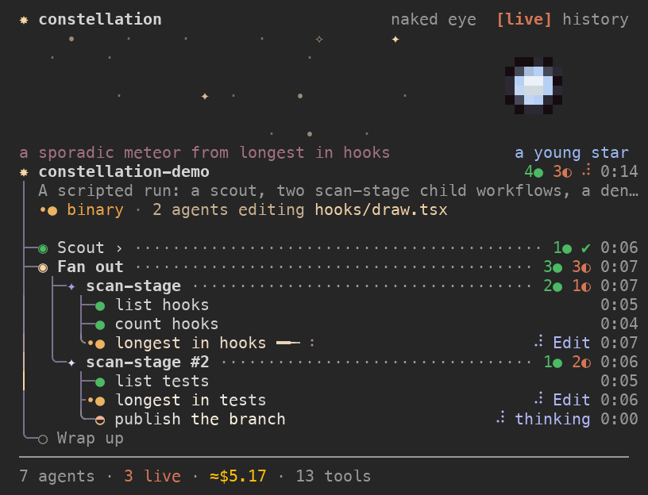</p>

<p align="center">
Every Workflow run becomes a constellation in a pane beside the chat. Its agents are moons,
and what they go through shows up as astronomical events: a comet behind a straggler,
meteors for failing calls, an eclipse when the session is waiting on you.
</p>

At the Claude Code prompt:

```
/plugin install constellation --marketplace Jpgomesf/constellation
```

From a shell:

```sh
claude plugin install constellation --marketplace Jpgomesf/constellation
```

In the desktop app: press **+** next to the prompt box, choose **Plugins**, then **Add marketplace** with `Jpgomesf/constellation`, then **Add plugin**.

## Quick start

```
/constellation demo
```

This plays a scripted 39-second run with every event in it. No agents run and no tokens are spent. Then try:

- `/constellation demo star`: a 40-second life of the dying star.
- `/constellation demo tour`: the sky styles, one after another.

In real work you don't have to do anything. The pane opens by itself when a Workflow starts (the `autoOpen` option, on by default), and `/constellation` opens it whenever you want.

## The pane

The **tree** is the run itself:

| Glyph | Is |
| --- | --- |
| ✦ | a Workflow run, twinkling while it runs |
| ◉ | a phase (○ before it starts) |
| ✦ ✧ | a child workflow, a workflow run inside a workflow (✦ while it runs) |
| ◐ ◓ ◑ ◒ | an agent at work: a moon turning through its phases |
| ● ✗ | an agent that finished, or failed |

Plain subagents get a group of their own. Above the tree is the **sky band**, where the events play out and the **dying star** stands for your context window. The **history** tab lists past runs. Press any node's name to **inspect** it: its prompt, tools, permissions and answer.

## The sky

### Eclipse: waiting on you

The main session is waiting on you: a permission prompt, a question or an elicitation. A dark moon slides over the session's star, and the band's caption reads `eclipse · waiting on you (Write permission)`, as in the hero GIF above. The grid below shows the eclipse itself over each stage of the star, which it meets at whatever stage it has reached. A protostar shows only a faint ring. From a young star into the red giant the eclipse is total, a dark disc in a bright corona, with the moon growing as the star does. Once the star outgrows the largest moon, late in the red giant and beyond, it leaves an annular ring of fire. When you answer, a diamond ring and a crescent show as the moon slides off.

<table>
<tr>
<td align="center">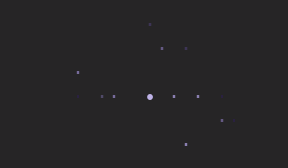<br><sub>a protostar</sub></td>
<td align="center">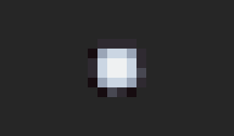<br><sub>a young star</sub></td>
</tr>
<tr>
<td align="center">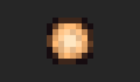<br><sub>a steady star</sub></td>
<td align="center">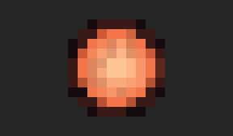<br><sub>swelling · red giant</sub></td>
</tr>
<tr>
<td align="center">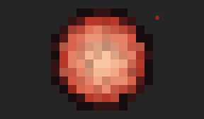<br><sub>unstable · shedding</sub></td>
<td align="center">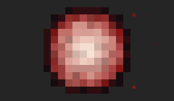<br><sub>dying · compact soon</sub></td>
</tr>
</table>

<sub>Each star is held at one stage, as it is while the session waits on you, and drawn at the same scale by the eclipse's preview scenes (`dev/previews/eclipse.ts`).</sub>

*Detected from* the main session's permission asks that only you can answer (`tool.check`), permission dialogs and elicitations. The call's result or your answer ends it.

### Retrograde: an agent stuck in a loop

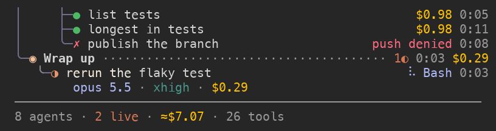

An agent repeating the same tool call goes retrograde, as a planet's apparent motion does. At the third identical call its moon slows to a stop (stationary); from the fourth it turns backwards in white, a phase further back with each repeat, with the reason under it: `retrograde · same Bash call ×5`. A different call sets it direct again.

*Detected from* each agent's tool calls in `turn.step`, keyed by tool and input: the same call again and again, or two or three calls taking turns. Polling a background job (GetTask, TaskList, Monitor…) or sleeping in Bash counts as waiting, and takes many more rounds.

### Binary star: two agents, one file

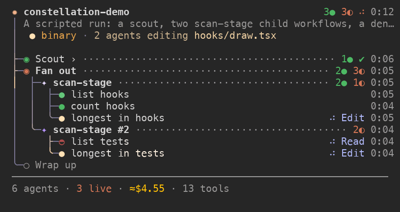

Two running agents editing the same file orbit each other, and the run warns `binary · 2 agents editing hooks/draw.tsx`. It's an early warning of an edit conflict.

*Detected from* the writes `tool.check` lets each agent make (Edit, Write, NotebookEdit), file by file.

### Comet: a straggler

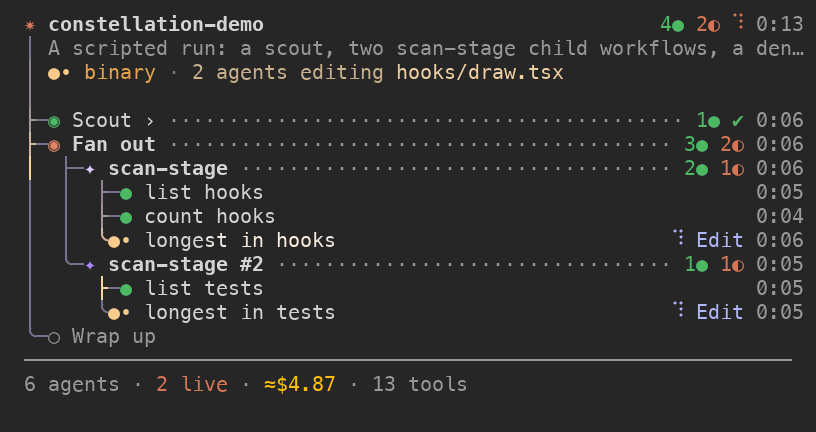

An agent running much longer than its siblings grows a comet tail behind its name, solid and then faint. The tail gets longer as the agent falls further behind.

*Detected from* the tree itself: an agent's running time against how long its finished siblings took. No hook is needed.

### Meteor shower: failing calls

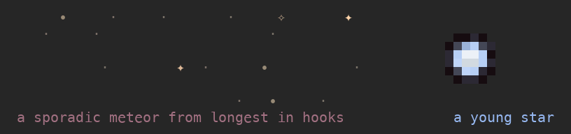

Failed or denied tool calls fall as meteors across the sky. Many at once make a shower, and the caption names the agent they come from.

*Detected from* tool results marked as errors and `tool.check` denials, counted per agent over a sliding minute.

### Red / blue shift: prompt-cache health

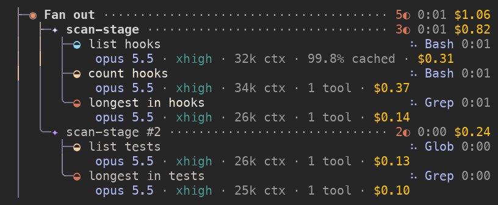

A moon whose prompts are mostly served from cache shifts blue. One paying for fresh tokens shifts red, a dim garnet. Through the telescope it reads `N% cached`.

*Detected from* each step's token usage in `turn.step`: cache reads against fresh input and cache writes.

### The dying star: your context window

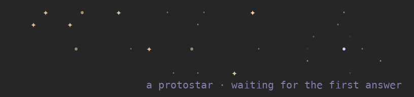

The main session's context window, drawn as a pixel-art star (shown here at 4× speed). It ages from a young star to a steady star, a red giant, unstable and shedding, then dying. It goes supernova and is reborn when the session compacts, leaving a nebula ring for each death. It shows stage words, never numbers.

*Detected from* `session.measure`, which reports the context window.

### Sky styles

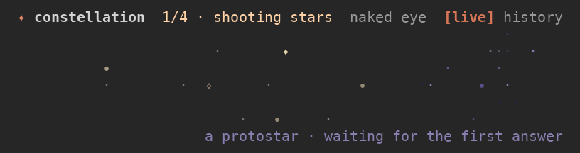

Five styles for the band: `stars` (the default), `shooting`, `map`, `parallax` and `spark`. `/constellation demo tour` plays them in turn, and `/constellation sky <style>` keeps one.

## Detail levels

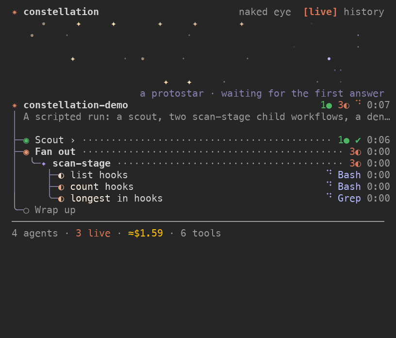

| Level | Shows |
| --- | --- |
| **naked eye** (default) | just the stars: who's running, what tool, how long |
| **binoculars** | each agent's model, effort and cost |
| **telescope** | everything: context, tool count, cache share and each event's facts |

Cost and tool totals show once, in the footer. `/constellation detail <level>` picks a level. With no level it steps to the next, and so does pressing the level word in the header. Your choice is remembered.

## Commands

| Command | Does |
| --- | --- |
| `/constellation` | opens the pane (same as `open`) |
| `/constellation close` | closes it |
| `/constellation clear` | hides finished runs and ended subagents from the live view (history keeps them) |
| `/constellation history`, `live` | switches tabs |
| `/constellation demo` | plays the scripted run with every event, no tokens spent |
| `/constellation demo star` | plays a 40-second life of the dying star |
| `/constellation demo tour` | plays the sky styles over the scripted run |
| `/constellation demo <style>` | plays the scripted run in one sky style |
| `/constellation sky <style>` | keeps a sky style: `stars`, `shooting`, `map`, `parallax` or `spark` |
| `/constellation detail [level]` | `naked-eye`, `binoculars` or `telescope`; no level steps to the next |

## How it watches

Every hook only observes. No tool call is wrapped, delayed or changed. The sky is read from:

- the run's journal on disk (`subagents/workflows/<runId>/journal.jsonl`);
- `turn.step`, for each agent's model, effort, context and cache usage;
- `tool.check`, for permission decisions;
- tool-result rows, for failures;
- `session.measure`, for the context window.

Costs are estimates at list price.

## How it was made

Constellation was built in Claude Code sessions, on Claude Code's mod API: hooks registered with `on(event, hook)`, a `$.ui` pane drawn by `ui.render`, and state atoms between them.

**The first version** brought the constellation tree, a small motion engine in TypeScript (easing, twinkles, shimmer, comets running down the tree's rails, about 30 fps while something moves), the dying star, history, the inspector and five sky styles.

**A sandbox that sees what the terminal sees.** `dev/sandbox.py` drives a real Claude Code session in a pseudo-terminal (pyte) or a real kitty window and saves frames. Every look was judged as a terminal actually paints it, not from text dumps. The GIFs on this page come from the same sandbox.

**A workflow of workflows.** Twelve ideas for astronomical events were brainstormed, and seven were built, of which six ship. One workflow ran the others to build them:

- a harness agent built a preview harness (`dev/preview.ts`);
- seven child workflows built the event modules in parallel, each one build → independent review → fix, 22 agents in all;
- a planning workflow (architect → critic → revision) wrote an 11-step integration plan;
- an integration workflow wired the events in.

Each event is a pure module with its own tests and its own preview.

**One review at the end** found the only real bug. An agent polling a background job looked like a loop and was flagged as stuck. Polling tools now count as polls.

**Art passes in a real terminal** settled the looks. The eclipse went from a square box to a round ring, the red shift went from error red to garnet, the binary pair moved off the label, and the comet kept its solid-then-faint tail. The black hole became retrograde: a moon turning backwards reads at one character, where a black hole was forced.

**The lesson:** gating every step on its own reviewer and screenshot doubled the time and found no behaviour bugs. One review at the end found the only real one.

## Develop

```sh
claude --plugin-dir .                         # run the mod from this checkout
npx -p typescript tsc -p . --noUnusedLocals   # type-check (after one load has written .claude-plugin/types/)
claude plugin test .                          # the tests, 166 in 7 files
claude plugin validate .                      # the manifest
bun dev/preview.ts dev/previews/comet.ts      # one event's scenes in your terminal
uv run --with pyte --with pillow dev/sandbox.py --keys "/constellation demo" --at 4,16,24   # frames of a real session
```

The GIFs on this page are rebuilt with one command each, in a pseudo-terminal: from a real Claude Code session (no model calls, no tokens), or for the eclipse stages from the eclipse's preview.

```sh
uv run --with pyte --with pillow dev/gif.py hero   # or retrograde, binary, comet, meteor, shift, star, skies, levels,
                                                   # eclipse-protostar, eclipse-young, eclipse-steady,
                                                   # eclipse-giant, eclipse-unstable, eclipse-dying
uv run --with pyte --with pillow dev/gif.py all    # every GIF
```

`--help` lists them, `--reuse` redraws from the last recording without starting Claude Code, and `--frames` keeps every frame for a look. The detail level is shared with your real sessions, so a recording sets the level it needs and ends on `naked-eye`. It draws with macOS's fonts (Menlo, Apple Symbols).

## License

[MIT](LICENSE)
